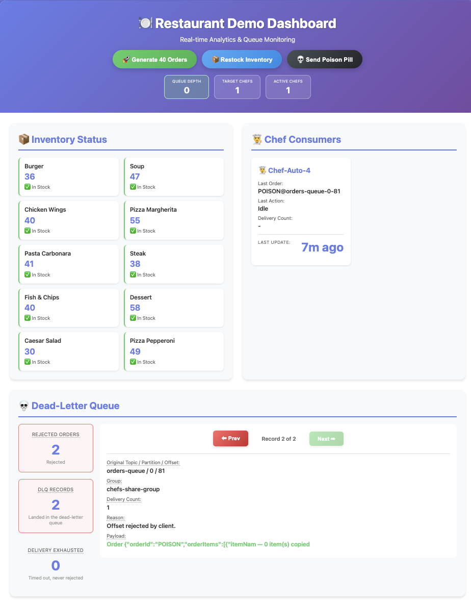
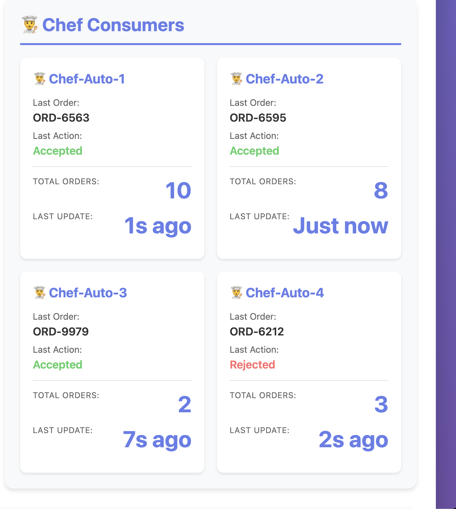

# Queues for Kafka Demo

[Queues for Kafka](https://cwiki.apache.org/confluence/display/KAFKA/KIP-932%3A+Queues+for+Kafka) (KIP-932) brings true queue semantics to Apache Kafka through **share groups**. Unlike traditional consumer groups where each partition is exclusively assigned to one consumer, share groups allow multiple consumers to process messages from the same partition concurrently, while Kafka still ensures each message is delivered to exactly one consumer at a time.

This demo (based on [ifnesi's original](https://github.com/ifnesi/queues-for-kafka)) turns that into a restaurant kitchen:

- **Waiters** (producers) submit orders to a Kafka topic
- **Chefs** (share group consumers) each grab orders off the queue
- An **inventory tracker** (standard consumer) watches all orders flow through
- A **dashboard** ties it all together with live scaling based on queue depth



> **Preview: dead-letter queue (DLQ) support.** This branch adds DLQ support for share groups
> ([KIP-1191](https://cwiki.apache.org/confluence/display/KAFKA/KIP-1191%3A+Dead-letter+queues+for+share+groups)),
> built against the `apache/kafka:4.4.0-rc4` release candidate ahead of the official AK 4.4 GA.
> It's open for review and iteration via this PR before AK 4.4 actually ships — comment on the
> PR with changes, and they'll land as further commits on this branch.

## Do you prefer Python?

Check out the [Python version of this demo](queues-for-kafka-demo-python/README.md), which implements the same waiters/chefs/inventory-tracker scenario using `confluent-kafka-python` instead of the Java client.


## Prerequisites

- [Java 17+](https://www.oracle.com/java/technologies/javase/jdk17-archive-downloads.html)
- [Maven](https://maven.apache.org/install.html)
- [Terraform](https://developer.hashicorp.com/terraform/install) (for Confluent Cloud deployment)

**Mac (Homebrew):**

```bash
brew install openjdk@17 maven terraform
```


## Getting Started

There are two ways to run this demo. The standard version quickly shows the capabilities of Queues for Kafka with a custom autoscaler. The Kubernetes Event-driven Autoscaling (KEDA) version uses Kubernetes for scaling, using Prometheus to publish metrics near-real-time from the Kafka Admin API. This version simulates a production environment and requires some additional configuration. 

To run the standard version, continue in this README. To run the KEDA version, jump to the [KEDA Autoscaling README](keda-scaler/README.md).

### 1. Deploy a Confluent Cloud cluster

You need a Kafka cluster with Queues for Kafka enabled. The included Terraform creates a Dedicated cluster with a public endpoint and the API keys you'll use to connect.

First, create a **Cloud resource management API key** in Confluent Cloud.

1. Go to https://confluent.cloud/settings/api-keys
2. Click **Add API key**, select **Cloud resource management**
3. Save the key and secret

Then run Terraform:

```bash
cd terraform
terraform init
terraform apply
```

You'll be prompted for the key and secret you just created. Provisioning the Dedicated cluster can take some time. The topic you'll use, `orders-topic`, is created as part of the Terraform deployment as well. Once the provisioning finishes, load the connection details into your shell:

```bash
eval "$(terraform output -raw demo_env)"
```

This exports `BOOTSTRAP_SERVERS`, `CONFLUENT_API_KEY`, and `CONFLUENT_API_SECRET` so the demo apps can connect.

```bash
cd ..
```

<details>
<summary><strong>Alternative: Local Kafka with Docker</strong></summary>

No Confluent Cloud account? You can run against a local broker instead (some QfK features are Confluent Cloud-only).

This demo currently runs against `apache/kafka:4.4.0-rc4`, an Apache Kafka 4.4.0 release
candidate, so that the dead-letter queue steps below work ahead of the AK 4.4 GA. Once AK 4.4
ships, this tag should be bumped to the GA image (e.g. `apache/kafka:4.4.0`).

```bash
docker run --name kafka_qfk --rm -p 9092:9092 apache/kafka:4.4.0-rc4
```

In a new terminal, enable share groups and create the topic:

```bash
docker exec -it kafka_qfk sh -c "
  /opt/kafka/bin/kafka-features.sh --bootstrap-server localhost:9092 upgrade --feature share.version=2 &&
  /opt/kafka/bin/kafka-topics.sh --bootstrap-server localhost:9092 --create --topic orders-queue --partitions 1
"
```

No environment variables needed — the demo defaults to `localhost:9092`.

#### Dead-letter queue (DLQ) setup

[KIP-1191](https://cwiki.apache.org/confluence/display/KAFKA/KIP-1191%3A+Dead-letter+queues+for+share+groups)
adds dead-letter queue support for share groups, targeted at AK 4.4. A rejected order, or one
that exhausts its delivery attempts, is written to a DLQ topic instead of just disappearing.
`share.version=2` (enabled above) turns this on.

Create a DLQ topic, mark it as a valid DLQ destination, and point `chefs-share-group` at it:

```bash
docker exec -it kafka_qfk sh -c "
  /opt/kafka/bin/kafka-topics.sh --bootstrap-server localhost:9092 --create --topic dlq.orders-queue --partitions 1 &&
  /opt/kafka/bin/kafka-configs.sh --bootstrap-server localhost:9092 --alter --entity-type topics --entity-name dlq.orders-queue --add-config errors.deadletterqueue.group.enable=true &&
  /opt/kafka/bin/kafka-configs.sh --bootstrap-server localhost:9092 --alter --entity-type groups --entity-name chefs-share-group --add-config errors.deadletterqueue.topic.name=dlq.orders-queue
"
```

By default, DLQ records carry only context headers (topic, partition, offset, group, delivery
count, rejection reason) — not the original order. To also copy the original order onto the DLQ
record, set the group's `errors.deadletterqueue.copy.record.enable` config:

```bash
docker exec -it kafka_qfk sh -c "
  /opt/kafka/bin/kafka-configs.sh --bootstrap-server localhost:9092 --alter --entity-type groups --entity-name chefs-share-group --add-config errors.deadletterqueue.copy.record.enable=true
"
```

`DlqConsumer` (see [Reading the DLQ via CLI](#6-reading-the-dlq-via-cli-optional) below) reads
either way: it always prints the context headers, and additionally prints the original order when
its payload was copied.

**Set this before any chef connects.** The DLQ config does not apply retroactively to a share
group that's already active — if `chefs-share-group` already has consumers running when you set
`errors.deadletterqueue.topic.name`, rejected orders keep disappearing with no error and no DLQ
record, even though `kafka-configs.sh --describe` shows the config is set. If you already started
chefs, stop them first so the group empties, then start them again after configuring the DLQ.

</details>

### 2. Compile the project

```bash
mvn clean compile
```

### 3. Start the Dashboard

```bash
mvn exec:java -Dexec.mainClass=com.example.qtest.DashboardServer
```

Open http://localhost:8080 and you'll see an empty kitchen, no orders yet.

### 4. Start the Producer

On the dashboard, click the "Generate 40 Orders" button. The producer fires off 40 orders immediately to flood the kitchen, then keeps a steady stream going. Now, on the dashboard, you'll see chefs spin up to handle the backlog, then scale back down as the queue drains.

### 5. See the DLQ in the Dashboard

The dashboard tracks DLQ activity live. Queue Depth, Target Chefs, and Active Chefs are quick-glance
chips right in the header, next to the action buttons. Further down, the Dead-Letter Queue section
shows Rejected Orders, DLQ Records, and Delivery Exhausted side by side with a record-by-record
inspector (Prev/Next through each DLQ record's headers and payload). Hover any label for an
explanation of what it means.

### 6. Reading the DLQ via CLI (optional)

If you'd rather read the DLQ topic directly instead of through the dashboard:

```bash
mvn exec:java -Dexec.mainClass=com.example.qtest.DlqConsumer
```

This prints each DLQ record's context headers (original topic/partition/offset, the group,
delivery count, and rejection reason). If the group also has
`errors.deadletterqueue.copy.record.enable=true` set, it additionally prints the original order
that was copied onto the DLQ record.

### 7. Trigger a poison pill

Click "Send Poison Pill" on the dashboard. It produces one deliberately non-parseable record
straight onto `orders-queue` — not a real order, just truncated JSON bytes. Whichever chef polls
it next hits a genuine deserialization failure (`RecordDeserializationException`), which the chef
catches and rejects by topic/partition/offset instead of crashing, since there's no parsed value
to pass to the normal acknowledge path. It lands on the DLQ exactly like any other rejected
record — open the inspector and you'll see the actual garbled payload bytes, not a clean order.

The same raw record also reaches `InventoryConsumer`, a separate consumer group reading the same
topic. It has no DLQ concept (it's a plain consumer, not a share consumer), so instead it catches
the same exception and seeks past the bad offset, dropping it and continuing — both consumers
survive the same bad message, via two different recovery paths.


## What to Look For

### Accept, Release, Reject

Share groups give consumers four ways to handle a message, which is new for Kafka:

| Action | What Happens |
|--------|--------------|
| **Accept** | Done — message is acknowledged and leaves the queue |
| **Release** | Put it back — another consumer will pick it up |
| **Reject** | Discard it (a genuine poison pill — see [Trigger a poison pill](#7-trigger-a-poison-pill)) — lands on the DLQ topic if the group has one configured, otherwise it's gone for good |
| **Renew** | Extend the time allowed for processing the message |

In this demo, a chef only ever issues Reject for a real reason: a genuine poison pill. It's never
an arbitrary coin flip on a well-formed order. The other real path into the DLQ is a record that
exhausts its delivery attempts via repeated Release — the dashboard tracks this separately as
Delivery Exhausted, alongside Rejected Orders and DLQ Records.



### Auto-Scaling

The dashboard watches queue depth and spins chefs up or down automatically. When the producer sends that initial burst of 40 orders, you'll see chefs appear to handle the spike, then disappear as things calm down.

### Multiple Consumers, One Partition

In traditional Kafka, one partition means one consumer per group. Share groups break that rule by allowing multiple consumers in a single group. The topic in this demo runs with a single partition, but scales to as many chefs as needed.

### Queuing and Streaming Side by Side

The demo runs both patterns on the same topic at the same time:

- A **share group** (`chefs-share-group`) for queue-style processing — each order goes to one chef
- A **standard consumer group** (`inventory-analytics-group`) for streaming — the inventory system sees every order


## Teardown

Tear down the Confluent Cloud resources when you're done to stop billing:

```bash
cd terraform
terraform destroy
```

If you used local Docker instead:

```bash
docker stop kafka_qfk
```


## Learn More

- [KIP-932: Queues for Kafka](https://cwiki.apache.org/confluence/display/KAFKA/KIP-932%3A+Queues+for+Kafka)
- [Confluent Developer Portal](https://developer.confluent.io)
